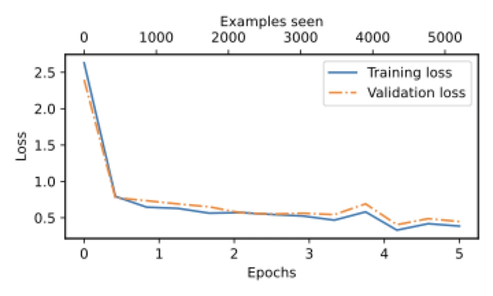

# GPT-2 spam classifier: re-wire a language model to answer "spam or not spam"


[](https://colab.research.google.com/github/KaramAbuMokh/fine-tune-GPT2-on-spam-email-classification/blob/main/fine_tuning.ipynb)

The same hand-written GPT-2 as in my [Game of Thrones project](https://github.com/KaramAbuMokh/LLM-and-transformer-structure-explained),
re-wired to read a text message and answer one thing: spam or not spam. A language model normally picks the next word out
of 50,257. Here its output layer is swapped for a 2-way one, and only the last transformer block and that new layer are
trained.

**Try it:** the classifier is also served by my demo Space,
[huggingface.co/spaces/karamAM/gpt2-demos](https://huggingface.co/spaces/karamAM/gpt2-demos) (the page there is built for
the Game of Thrones model; the spam classifier answers through the Space's API with `task_name` set to `spam`). It was
trained on short text messages, so a long email-style note can come back as spam.

## What the notebook does

1. Downloads the [SMS Spam Collection](https://archive.ics.uci.edu/dataset/228/sms+spam+collection) from the UCI Machine
   Learning Repository: 5,572 messages, 4,825 normal and 747 spam.
2. Balances it by sampling 747 normal messages to match the 747 spam ones, then splits it 70% / 10% / 20%:
   1,045 training, 149 validation and 300 test messages.
3. Builds the GPT-2 network by hand (feed-forward, multi-head attention, transformer block, model) and loads OpenAI's
   released GPT-2 small (124M) weights into it.
4. Freezes the whole network, swaps the output layer for a 2-way layer, and unfreezes the last transformer block and the
   final layer norm.
5. Fine-tunes for 5 epochs (AdamW, learning rate 5e-5, batches of 8 messages padded to 120 tokens), tracking loss and
   accuracy.
6. Classifies new messages with `classify_review`.

## Results

| Measure | Accuracy |
|---|---|
| Before fine-tuning, on 80 test messages (10 batches of 8) | 48.75% |
| After fine-tuning, training set | 81.35% |
| After fine-tuning, validation set | 81.88% |
| After fine-tuning, all 300 test messages | **84.00%** |

Before training the model is a coin flip, as expected. These numbers come from my first full run of this code on Colab
(CPU, about 65 minutes). The notebook in this repository is saved without outputs, so run it yourself to reproduce them.



*Training and validation loss over the 5 epochs.*

## How to run it

1. Open `fine_tuning.ipynb` in [Google Colab](https://colab.research.google.com/) (a GPU makes it much faster than the CPU
   run above), or in Jupyter.
2. Set `finetuning_dir_path` in the first code cell to a working folder.
3. Run the cells from top to bottom. The data download, the OpenAI weights download and the training all happen in the
   notebook. Plain `python` packages needed: `torch`, `pandas`, `tiktoken`, `matplotlib`, `numpy`, `tensorflow` (only to
   read OpenAI's original weight files) and `tqdm`.

## Project structure

```
.
├── fine_tuning.ipynb                        # data, GPT-2 from scratch, weights, fine-tuning, classifier
├── docs/
│   └── training-loss-spam-classifier.png    # loss plot shown above
└── README.md
```

## Related

- [LLM-and-transformer-structure-explained](https://github.com/KaramAbuMokh/LLM-and-transformer-structure-explained):
  the same GPT-2 fine-tuned on the *A Song of Ice and Fire* books to answer questions.
- [LLMs](https://github.com/KaramAbuMokh/LLMs): the FastAPI and Docker service that serves both models.
